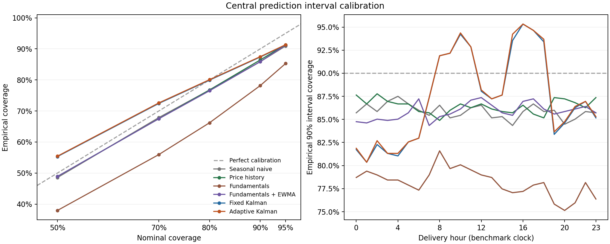
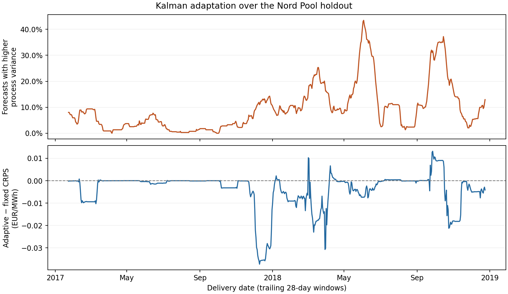
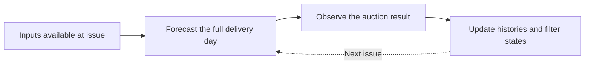

# Nord Pool Day-Ahead Price Forecasting

A reproducible study of probabilistic day-ahead electricity price forecasts for Nordic Nord Pool. It asks whether a Kalman correction that adjusts to persistent forecast errors improves on a fixed correction and simple residual updating.

> **Main finding.** Adaptive Kalman achieved the lowest continuous ranked probability score (CRPS) across **17,472 held-out delivery hours**, improving on fixed Kalman by **0.20%** and on exponentially weighted residual updating by **9.3%**.

[Holdout results](#holdout-results) · [Forecast diagnostics](#forecast-diagnostics) · [Backtest design](#backtest-design) · [Reproduce the evaluation](#reproduce-the-evaluation)

## Holdout results

All models were scored on the same hourly observations from **27 December 2016 to 24 December 2018**. CRPS evaluates the full forecast distribution and is the primary metric. Mean absolute error (MAE) uses the forecast median. CRPS, MAE and interval width are in EUR/MWh. [Download the score table](results/tables/holdout_evaluation/test_scores.csv)

| Model | Mean CRPS ↓ | MAE ↓ | 90% interval coverage | Mean 90% width |
| --- | ---: | ---: | ---: | ---: |
| **Adaptive Kalman** | **1.9347** | **2.5351** | 87.49% | 10.3869 |
| Fixed Kalman | 1.9386 | 2.5395 | 87.37% | 10.3663 |
| Price history | 2.0568 | 2.6475 | 86.44% | 11.2613 |
| Fundamentals + EWMA | 2.1324 | 2.8793 | 85.86% | 11.2046 |
| Seasonal naive | 3.2301 | 4.1605 | 85.87% | 17.8803 |
| Fundamentals | 3.3724 | 4.7751 | 78.17% | 14.3673 |

The adaptive-minus-fixed CRPS difference was **−0.0040 EUR/MWh**. A paired bootstrap that kept seven consecutive auction days together gave a 95% interval of **−0.0074 to −0.0011 EUR/MWh**. Intervals from 14- and 28-day blocks also favored adaptation. [Paired differences and sensitivity checks](results/tables/holdout_evaluation/paired_crps.csv)

Fixed Kalman scored slightly better on the **1,289 high-price hours** above the training-set 99th percentile. Its mean CRPS was **3.5562**, compared with **3.5664** for adaptive Kalman. [High-price and negative-price diagnostics](results/tables/holdout_evaluation/stress_scores.csv)

## Forecast diagnostics

### Interval calibration



The diagonal on the left marks ideal calibration. All models fell short of nominal 90% coverage overall. For adaptive Kalman, coverage at that level ranged from 80.4% to 95.3% by delivery hour. [Calibration by nominal level](results/tables/holdout_evaluation/calibration_by_level.csv) · [Calibration by delivery hour](results/tables/holdout_evaluation/calibration_by_hour.csv)

### When the filter adapted



The upper panel shows how often adaptation raised process variance. It did so for 9.48% of all scored hours. The lower panel shows the rolling CRPS difference, with values below zero favoring the adaptive filter. The timing of the gains varied across the holdout. [Daily adaptation and score differences](results/tables/holdout_evaluation/adaptation_by_day.csv)

## Backtest design

The EPF Toolbox Nordic Nord Pool benchmark provides hourly day-ahead auction prices and forecasts of load and wind generation. The replay issues 24 marginal price distributions per delivery day on the benchmark's regular hourly grid. The nominal issue label is **11:00 on the preceding day**. The source omits original publication timestamps and revisions, so the availability of load and wind forecasts at that cutoff is assumed. [Benchmark dataset documentation](https://epftoolbox.readthedocs.io/en/latest/modules/data_extract.html) · [Project data dictionary](data/processed/nord_pool/data_dictionary.json)

| Split | Delivery dates | Used for |
| --- | --- | --- |
| Training | 1 Jan 2013 to 28 Dec 2015 | Regression fitting and Kalman noise estimation |
| Validation | 29 Dec 2015 to 26 Dec 2016 | Selecting the adaptive settings |
| Holdout | 27 Dec 2016 to 24 Dec 2018 | Comparing the six models |



- **Baselines.** The seasonal naive model uses the same hour one week earlier. The price-history regression uses lagged prices and calendar features. The fundamentals regression uses load, wind and calendar features. The fourth model adds an exponentially weighted moving average (EWMA) of past fundamentals errors. Baseline distributions use recent forecast errors for the same hour.
- **Fixed Kalman.** A separate filter for each delivery hour estimates a persistent bias in the fundamentals forecast. The bias follows a random walk, and the Gaussian predictive distribution includes state uncertainty and observation noise. The process and observation variances are estimated from training data.
- **Adaptive Kalman.** The adaptive filter smooths clipped standardized forecast errors and increases process variance for the next auction when the magnitude of that signal exceeds a threshold. This lets the estimated bias respond faster to persistent errors. The smoothing rate and adaptation strength were selected on validation data. [Validation tuning table](results/tables/holdout_evaluation/validation_tuning.csv)

## Reproduce the evaluation

Run these commands from the repository root. The workflow was verified with Python 3.10.11.

```bash
python -m pip install -r requirements.txt
python src/electricity_forecasting/prepare_dataset.py
python -m src.electricity_forecasting.evaluate_holdout
python -m unittest discover -s tests -v
```

The preparation script downloads the benchmark and applies the chronological split. The evaluation regenerates the summary tables, plots and hourly forecast export. [Original benchmark file](https://zenodo.org/records/4624805/files/NP.csv) · [Reproduction details and source checksum](docs/step-6-evaluation.md#reproduce-the-analysis)

## Explore the repository

| Resource | Contents |
| --- | --- |
| [Evaluation report](docs/step-6-evaluation.md) | Protocol, full findings and limitations |
| [Source notes](docs/data-sources.md) | Market data, forecast timing and benchmark rationale |
| [Forecasting code](src/electricity_forecasting/) | Data preparation, auction replay and model evaluation |
| [Holdout results](results/tables/holdout_evaluation/) | Scores, calibration, stress metrics and adaptation traces |
