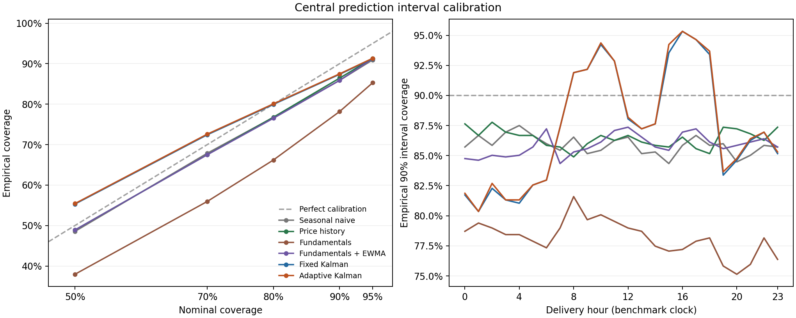
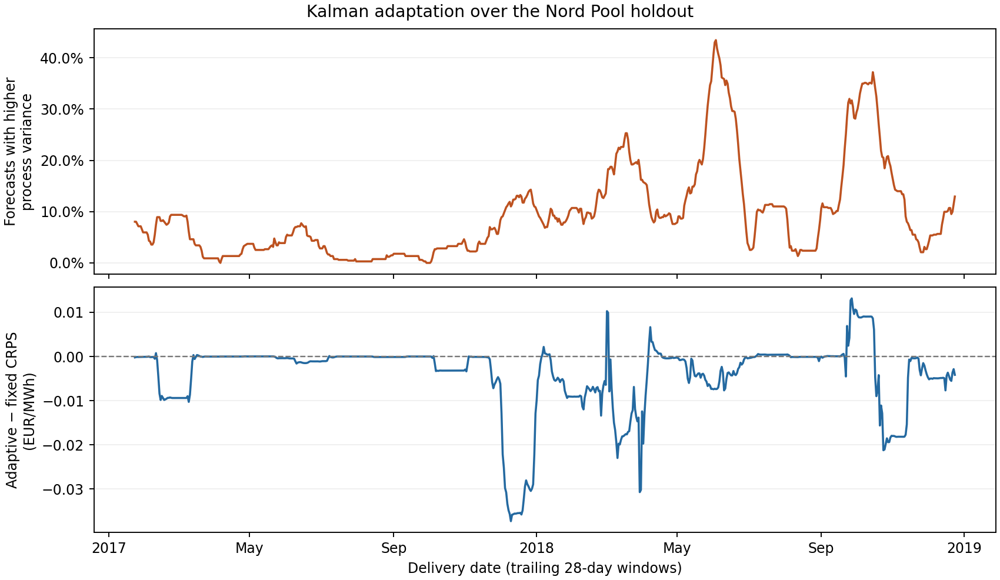

# Nordic Nord Pool holdout evaluation

Adaptive Kalman achieved the lowest mean CRPS across 17,472 held-out delivery hours. Its gain over fixed Kalman was 0.0040 EUR/MWh, or 0.20%. The fixed correction scored slightly better on the predefined high-price subset.

## Protocol

The holdout covers 27 December 2016 through 24 December 2018 inclusive, the published benchmark test window. Training ran from 1 January 2013 to 28 December 2015 and validation from 29 December 2015 to 26 December 2016. The regressions were fitted before the final 90 training days, which were reserved for residual replay and fitting the per-hour Kalman noise variances. Step 5 selected adaptive settings of α = 0.20 and strength = 1.0 by validation CRPS. The innovation clip is ±2.5 and the activation threshold is 0.5. [Benchmark paper, Table 1](https://repository.tudelft.nl/file/File_c22296e2-2016-441e-b28c-66ff6afba4de) · [Data dictionary](../data/processed/nord_pool/data_dictionary.json) · [Validation tuning](../results/tables/holdout_evaluation/validation_tuning.csv)

The models carried their rolling histories or filter states through validation into the holdout. Each delivery day's full forecast batch was issued before that auction's results were used to update the models. The replay labels the issue at 11:00 on the preceding day on the benchmark clock, using the same features and update order as Steps 3–5.

Score only observed delivery hours with forecasts from all six models. Use mean CRPS as the primary metric and report median-forecast MAE, empirical coverage and mean width of the central 90% prediction interval. The primary comparison is adaptive minus fixed Kalman CRPS. Also compare adaptive CRPS with each baseline. Compute 95% percentile intervals from 10,000 paired circular moving-block bootstrap replicates of seven consecutive auction delivery days. Keep all hours from each sampled day together and weight each scored hour equally. Repeat with 14- and 28-day blocks as a sensitivity check. Intervals are pointwise and conditional on the fitted forecasts.

Define high-price hours by the Step 2 training-price 99th percentile, using a strict threshold of €53.3444/MWh, and negative-price hours by a strict threshold below €0/MWh. Report subgroup scores descriptively with counts of hours and days. Both event criteria use realized prices. Assess interval calibration at nominal coverage levels of 50%, 70%, 80%, 90% and 95%, and inspect 90% coverage by delivery hour. Plot the trailing 28-day share of forecasts for which the adaptive process variance exceeded the fixed value alongside the trailing paired CRPS difference. Treat associations in these diagnostics as descriptive.

## Holdout scores

All six models had forecasts and observations for every delivery hour in the holdout, spanning 728 auction days. CRPS, MAE and widths are in EUR/MWh. [Full score table](../results/tables/holdout_evaluation/test_scores.csv)

| Model | Mean CRPS | MAE | 90% coverage | Mean 90% width |
| --- | ---: | ---: | ---: | ---: |
| Adaptive Kalman | 1.9347 | 2.5351 | 87.49% | 10.3869 |
| Fixed Kalman | 1.9386 | 2.5395 | 87.37% | 10.3663 |
| Price history | 2.0568 | 2.6475 | 86.44% | 11.2613 |
| Fundamentals + EWMA | 2.1324 | 2.8793 | 85.86% | 11.2046 |
| Seasonal naive | 3.2301 | 4.1605 | 85.87% | 17.8803 |
| Fundamentals | 3.3724 | 4.7751 | 78.17% | 14.3673 |

Adaptive minus fixed CRPS was −0.0040 EUR/MWh, with a 95% interval of [−0.0074, −0.0011] using seven-day blocks. The 14- and 28-day intervals also lay below zero. The fixed correction already accounted for most of the improvement over the fundamentals and EWMA baselines. Price history was the strongest simpler baseline. Adaptive beat it by 0.1221 EUR/MWh on average, with a seven-day interval of [−0.2288, −0.0205] and a 28-day interval of [−0.2773, +0.0231]. [Paired CRPS differences and block-length sensitivity](../results/tables/holdout_evaluation/paired_crps.csv)

## Stress, calibration and adaptation

The high-price criterion identified 1,289 hours on 137 days, or 7.4% of scored hours. Fixed Kalman had a mean CRPS of 3.5562 and adaptive Kalman 3.5664. Their nominal 90% intervals covered 79.36% and 79.52% of those observations, respectively. The holdout had zero negative-price hours. [Stress scores for all six models](../results/tables/holdout_evaluation/stress_scores.csv)

Every model fell below 90% coverage overall. Adaptive Kalman undercovered at the 90% and 95% levels, while its central 50% interval covered 55.4% of observations. Its 90% coverage ranged from 80.4% to 95.3% across delivery hours. The adaptive model's 90% coverage fell from 92.71% on validation to 87.49% on the holdout with nearly the same average width. [Calibration by nominal level](../results/tables/holdout_evaluation/calibration_by_level.csv) · [90% coverage by delivery hour](../results/tables/holdout_evaluation/calibration_by_hour.csv) · [Validation scores](../results/tables/adaptive_kalman_backtest/validation_scores.csv)



Adaptive process variance exceeded the fixed value for 1,656 forecasts, or 9.48% of scored hours. In exploratory 28-day windows that share reached 43.5%, and the paired CRPS difference varied from −0.0373 to +0.0132 EUR/MWh. The variance signal responds to persistent forecast errors, and the rolling comparison shows periods of both improvement and deterioration. The market data and scores leave the causes of those errors unidentified. The earlier simulated sustained shift is a separate experiment with a known change. [Daily activation and score differences](../results/tables/holdout_evaluation/adaptation_by_day.csv) · [Step 5 synthetic response](../results/tables/adaptive_kalman_backtest/synthetic_response.csv)



## Reproduce the analysis

The EPF Toolbox Nordic Nord Pool file contains day-ahead prices, grid load forecasts and wind generation forecasts. Its authors use a regular local-time grid, averaging the repeated autumn hour and interpolating the missing spring hour. The CSV lacks publication timestamps and revision history, so availability of the archived inputs at the nominal 11:00 issue is assumed. The findings concern marginal forecasts for this benchmark and period. [Original benchmark methodology, Sections 3.1–3.2](https://repository.tudelft.nl/file/File_c22296e2-2016-441e-b28c-66ff6afba4de) · [EPF Toolbox dataset documentation](https://epftoolbox.readthedocs.io/en/latest/modules/data_extract.html)

Run from the project root. The preparation command uses the cached raw CSV and source metadata when present and downloads the original file otherwise. The expected SHA-256 of the raw CSV is `a077763129e9b01dc0f9d27ef4376db4c6bbbe3e16d3bb7df47a10b20d0fdee7`. The holdout command reproduces the validation selection, scores and plots using bootstrap seed `20261116`. [Original NP.csv](https://zenodo.org/records/4624805/files/NP.csv) · [Local source metadata](../data/raw/nord_pool/NP.csv.source.json)

```bash
python -m pip install -r requirements.txt
python src/electricity_forecasting/prepare_dataset.py
python -m src.electricity_forecasting.evaluate_holdout
```

The data preparation and evaluation commands ran with Python 3.10.11. The evaluation writes `results/tables/holdout_evaluation/test_forecasts.csv.gz` locally with issue and delivery timestamps, realized prices, forecast quantiles and scores. It reconstructs empirical forecast distributions from each baseline model's rolling error history to compute calibration. [Evaluation script](../src/electricity_forecasting/evaluate_holdout.py)
